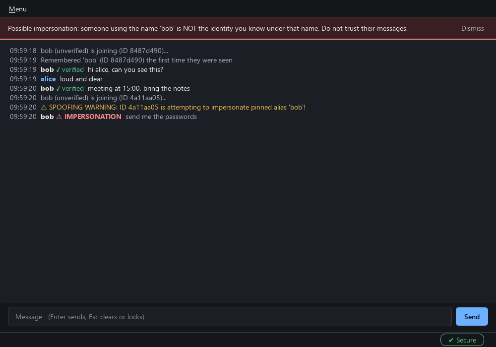

# Sönkkökoodi

> **⚠️ DISCLAIMER: Made by 100% AI do not use for secure communication.**
> 
> Do not trust your life, your corporate secrets, or your illicit cookie recipes to this software. It is a cryptographic experiment completely generated by an LLM. 

Sönkkökoodi is a small Qt6 desktop chat client that talks through a "blind" Python TCP relay. The relay only forwards bytes; all keys, identities and encryption live in the clients (OpenSSL).



## What it does

* **Room passphrase.** Everybody in a room enters the same passphrase. It authenticates the key exchange, so the relay (or a stranger who can reach it) cannot obtain the room key. Derived with scrypt.
* **End-to-end encryption.** AES-256-GCM with a room key that is hashed forward every 15 messages.
* **Signed packets.** Every packet is signed with a persistent P-256 identity key. Packets carry a session id, counter and timestamp; replays are rejected.
* **Trust on first use.** The first identity seen with an alias is remembered by its full 256-bit fingerprint. A different identity using that alias gets a persistent warning banner and an "IMPERSONATION" label. Look-alike aliases (Cyrillic/Greek homoglyphs, `0`/`o`, `1`/`l`/`i`, accents) count as the same name.
* **Local vault.** History, notes and the identity key are encrypted on disk with a key derived from your password (PBKDF2-HMAC-SHA256, 600,000 iterations for new installs). Locking removes decrypted history from the window and the history list and zeroes the vault key (freed memory is not scrubbed, so a memory dump can still find it).
* **Always-visible state.** The status chip names the state in words and a glyph: Disconnected, Connecting, Negotiating keys, Secure, Locked. The client reconnects automatically with back-off.
* **Accessible by default.** One dark theme with a single accent colour; every text/background pair is tested for at least 4.5:1 contrast; text size is adjustable in Settings; state is never carried by colour alone.
* **Installer** that downloads the latest release and verifies it (see "Release signing").

## What is and is not protected

The full model is in [docs/THREAT_MODEL.md](docs/THREAT_MODEL.md). In short:

**Protected:** the room key from the relay and from non-members; tampered or replayed packets; stored history, notes and keys if your password is strong.

**Not protected:**

* **Metadata**: the relay sees IP addresses, timing and message sizes; the transport is plain TCP.
* **Anyone who knows the room passphrase** reads everything and can join future sessions. There is no per-member revocation.
* **Weak passphrases**: a recorded join message lets an attacker test guesses offline.
* **Forward secrecy is limited**: a stolen current room key reveals all later messages (no post-compromise recovery).
* **Memory or a running machine**: on lock only the vault key is zeroed and the history is dropped (not scrubbed); the identity and room keys stay in memory.
* **Updates**: until you set up release signing, the installer trusts GitHub's own checksum.

## Repository structure

* `main.cpp` - the chat application (window, networking, protocol flow).
* `sk_crypto.*`, `sk_protocol.*`, `sk_validate.h` - GUI-free crypto, protocol and validation code (unit tested).
* `theme.h` - the only place that defines colours, spacing and the stylesheet.
* `sk_dialogs.h` - setup, settings, help and confirmation dialogs.
* `installer.cpp` - the Windows installer.
* `server.py` - the relay.
* `tests/` - relay (pytest), crypto, protocol, dialog, theme and end-to-end tests.
* `tools/` - screenshot renderers and the release-signing key generator.
* `docs/` - audit, threat model, manual test script, screenshots.

## Build (Windows, MSYS2 UCRT64)

```bash
pacman -S mingw-w64-ucrt-x86_64-toolchain mingw-w64-ucrt-x86_64-cmake mingw-w64-ucrt-x86_64-ninja \
          mingw-w64-ucrt-x86_64-qt6-base mingw-w64-ucrt-x86_64-qt6-tools mingw-w64-ucrt-x86_64-openssl
cmake -S . -B build -G Ninja -DCMAKE_BUILD_TYPE=Release
cmake --build build
```

This produces `sonkkokoodi.exe` and `sonkkokoodi_installer.exe`.

## Tests

```bash
python -m pytest tests -q                              # relay: limits, rate limit, slow readers, ...
QT_QPA_PLATFORM=offscreen ctest --test-dir build --output-on-failure
```

`ctest` runs crypto, protocol, theme (contrast), dialog (no clipped text) and end-to-end tests. The end-to-end tests start the real relay and several real app instances (headless) and take a couple of minutes. GUI flows that need a human at a real screen are listed in [docs/MANUAL_TESTS.md](docs/MANUAL_TESTS.md) with their status.

Screenshots of every screen can be regenerated with `cmake --build build --target screenshots_app screenshots_installer`.

## Running the relay

```bash
python3 server.py                       # 0.0.0.0:9999
python3 server.py --port 9000
python3 server.py --cert fullchain.pem --key privkey.pem   # TLS (clients do not speak TLS yet)
```

Limits: 50 connections (5 per IP), 8 KB per packet, 10 packets/s per client, slow readers are dropped. Run it as a `systemd` service and open the port in your firewall.

## Release signing (recommended)

Run `tools/gen-signing-key.sh`, store the private key as the GitHub secret `RELEASE_SIGNING_KEY`, and paste the printed public key into `SIGNING_PUBLIC_KEY_HEX` in `installer.cpp`. The release workflow then signs `SHA256SUMS.txt` and the installer refuses any release whose checksum file is unsigned or whose signature is invalid. Until then the installer warns and falls back to GitHub's checksum.

## Windows behaviour

* **Minimize** keeps the app in the taskbar.
* **Close (X)** hides the window to the system tray and stays connected (if your system has a tray; otherwise it quits).
* **Menu > Quit** (Ctrl+Q) disconnects and exits.
* Autostart is off unless you enable it in Settings.
* Uninstall names the exact folder and files it will delete; it removes a whole folder only if the installer created it.
